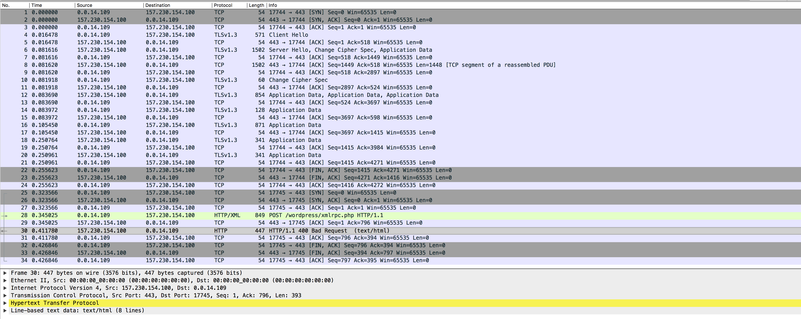
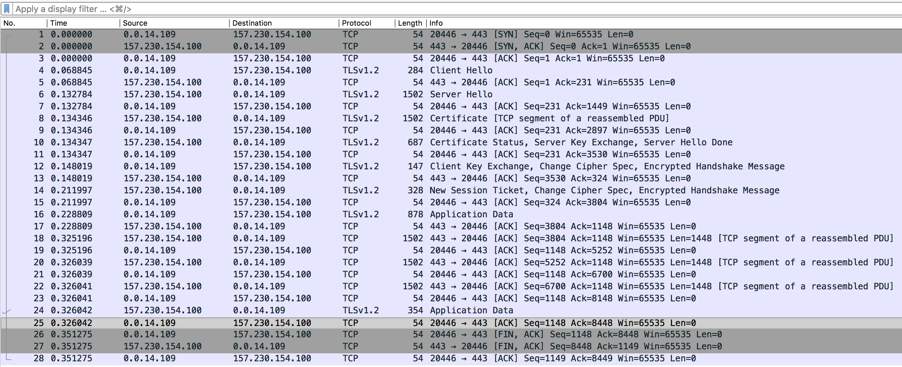

* Debugging Stories

Over the years various issues have surfaced. Most of them weren't worth mentioning because they were to small. But some of them were big that they deserved getting written down here!

After studying how debugging works you might enjoy seeing the outcome of an example or two.

When you are in the middle of a difficult issue:

- Turn detailed reporting on with =M-x org2blog-user-report-on= (or =UI [Reporting On]=).
- Reproduce the problem (login, save, publish, etc.).
- Then run =M-x org2blog-debug-report-collect= to create a single Org buffer that:
  - Records your environment and current blog configuration (with passwords /attempted/ to be redacted automatically.
  - Captures the tail of the =*Org WordPress Export*=, =request-data=, =func-call=, =*URL-DEBUG*=, and filtered =*Messages*= buffers.
- Carefully review the report buffer yourself to ensure it does not contain any secrets before you share it. When you are satisfied, save that report buffer to a file and attach it to your issue; this is far easier than copying individual debug buffers by hand.

** Can't Post Unicode

Suddenly Org2Blog couldn't post any content that contained Unicode characters. The problem was that when Emacs 26 came out its HTTP request library began enforcing correct byte usage for Unicode. The library itself worked fine. However clients of the library had to change. The solution was nearly a [[https://github.com/hexmode/xml-rpc-el/commit/8ee416cb7644eef4ca8edda5ea79b1c670555ad0][one line fix]].

** Inexplicably Can't Login Or Do Anything

For years everything was fine using Org2Blog, it just worked on my box. Then once in a while it didn't. And then it only worked one time out of ten. This was a major issue.

After testing every combination of every library nothing obvious jumps out. Finally I pull out WireShark and curl to see what is happening.

Take a look—

Here is what it looks like when it /doesn't/ work using Org2Blog:

Here is what it looks like when it /does/ work using curl:

Debugging at the communications layer was an absolute last resort—and it payed off. Unbeknownst to me the TLS version used is negotiated between the client and the server. For some reason my GnuTLS was negotiating v1.3 with the server and puked resulting it sending everything unencrypted over HTTP instead of encrypted over HTTPS!

The solution was pretty simple: forbid GnuTLS from using TLSv1.3:

#+name: org_gcr_2019-01-31T23-58-28-06-00_cosmicality_B75B85C4-2197-4893-9F13-70D0212F5E8D
#+begin_src emacs-lisp
(setq gnutls-algorithm-priority "NORMAL:-VERS-TLS1.3")
#+end_src

At least that was the /first/ solution.

As it would turn out this issue was caused by a bug in GnuTLS and by changing this setting it uninentionally avoided the error.

The issue was resolved in Emacs 26.3.

** Testing XML-RPC Calls With curl
:PROPERTIES:
:CUSTOM_ID: DebuggingWithCurl
:END:

Sometimes it helps to remove Org2Blog and Emacs from the picture entirely and test a single XML-RPC call directly with curl. This is especially helpful when you are working with your blog host or network team.

Here is a minimal, generic example using =wp.getTags=.

1. Capture a request body

From your debug report (via ~org2blog-debug-report-collect~) or from the =request-data= buffer, locate an XML body like this (values here are examples only):

#+begin_src xml :eval never
<?xml version="1.0" encoding="UTF-8"?>
<methodCall>
  <methodName>wp.getTags</methodName>
  <params>
    <param>
      <value>
        <string>1</string>
      </value>
    </param>
    <param>
      <value>
        <string>you</string>
      </value>
    </param>
    <param>
      <value>
        <string>&lt;redacted&gt;</string>
      </value>
    </param>
  </params>
</methodCall>
#+end_src

Save that XML into a file, for example: =test.xml=.

Before you save or share the file, carefully replace any real passwords, API keys, tokens, or other secrets with a placeholder such as =&lt;redacted&gt;=.

2. Call WordPress directly with curl

From a shell, run a command along these lines (adjusting the URL to match your blog and the filename if needed):

#+begin_src sh :eval never
curl 'https://yourblog.example/xmlrpc.php' \
     -H 'Content-Type: text/xml; charset=utf-8' \
     --data-binary @test.xml
#+end_src

3. Inspect the response

On success you should see an XML response that looks something like:

#+begin_src xml :eval never
<value><struct>
  <member><name>tag_id</name><value><int>428</int></value></member>
  <member><name>name</name><value><string>X11</string></value></member>
  <member><name>count</name><value><int>3</int></value></member>
  <member><name>slug</name><value><string>x11</string></value></member>
  <member><name>html_url</name><value><string>https://yourblog.example/tag/x11</string></value></member>
  <member><name>rss_url</name><value><string>https://yourblog.example/tag/x11/feed</string></value></member>
</struct></value>
#+end_src

If curl fails in the same way that Org2Blog does, then your host or network provider can use this small, self-contained example to debug the issue without needing to run Emacs or Org2Blog at all. If curl succeeds but Org2Blog does not, then the problem is more likely in Emacs, your configuration, or one of the libraries that Org2Blog uses.
